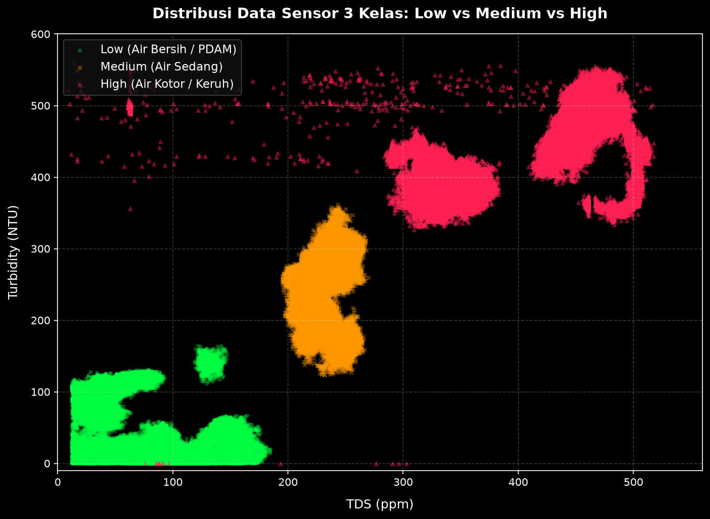

# 🌲 Edge AI Water Classification: Random Forest Model & Benchmark Report

Dokumen ini berisi penjelasan sistem **Edge AI Klasifikasi Kualitas Air** berbasis **Random Forest Classifier** yang dirancang khusus untuk deployment mikroprosesor **ESP32**.

---

## 🏆 Highlights: Model Utama Random Forest (Flagship Model)

Model **Random Forest (25 Decision Trees)** dipilih sebagai **Model Utama (Flagship)** untuk deployment ke ESP32 karena memberikan kombinasi terbaik antara **akurasi sempurna, stabilitas fisik, dan ketahanan terhadap lonjakan noise sensor**.

| Metrik Evaluasi | Hasil Benchmark | Keterangan |
| :--- | :---: | :--- |
| **Akurasi Pengujian Unseen Test Set** | **100.00%** | **Sempurna 100%** pada 8 file CSV baru yang belum pernah dilihat model |
| **5-Fold Group Cross Validation** | **99.54% ± 0.44%** | Terbukti konsisten tinggi di seluruh lipatan cross-validation |
| **Ukuran C++ Header (`rf_model.h`)** | **15.63 KB** | Sangat hemat memori (Hanya ~0.38% dari total 4 MB Flash ESP32) |
| **Waktu Inferensi ESP32** | **< 0.15 ms** | Super cepat di CPU ESP32 (240 MHz Dual Core) |
| **Sensitivitas Outlier** | **Ultra Low** | Sangat tahan terhadap lonjakan/noise instan pada sensor |

---

## 📊 1. Tabel Perbandingan Multi-Model Edge AI

Selain Random Forest, kami juga melatih dan membandingkan 4 algoritma klasifikasi lainnya untuk analisis komparatif:

| Algoritma Model | Akurasi File Test Unseen | 5-Fold Group CV Accuracy | Ukuran C++ Header (Flash ESP32) | Rekomendasi Deployment ESP32 |
| :--- | :---: | :---: | :---: | :---: |
| 🌲 **Random Forest (Flagship)** | **100.00%** | **99.54% ± 0.44%** | **15.63 KB** | ⭐⭐⭐⭐⭐ **MODEL UTAMA (DI-UPLOAD KE ESP32)** |
| ⚡ **Linear SVM** | **99.94%** | **99.85% ± 0.26%** | **1.49 KB** | ⭐⭐⭐⭐ (Tersimpan di Backup) |
| 📐 **Naive Bayes** | **100.00%** | **99.99% ± 0.02%** | **1.00 KB** | ⭐⭐⭐⭐ (Tersimpan di Backup) |
| 🌴 **Decision Tree (Single)** | **97.79%** | **98.59% ± 0.85%** | **1.16 KB** | ⭐⭐⭐ (Tersimpan di Backup) |
| 📍 **KNN (k=5)** | **100.00%** | **99.95% ± 0.09%** | **80.38 KB** | ⭐⭐⭐ (Tersimpan di Backup) |

### 📈 Visualisasi Sebaran Dataset 3 Kelas:


---

## ⚙️ 2. Metodologi Windowing & Feature Engineering

1. **Frekuensi Sampling**: 10 Hz (10 sampel per detik / interval 100 ms).
2. **Windowing 5 Detik**: Setiap 50 sampel dikelompokkan ke dalam 1 window inferensi.
3. **Ekstraksi Fitur Statis (8 Fitur Input)**:
   - `tds_mean`, `tds_std`, `tds_min`, `tds_max`
   - `turb_mean`, `turb_std`, `turb_min`, `turb_max`
4. **Strategi Split Bebas Leakage (`group_by_file`)**:
   - Pemisahan data training dan testing dilakukan berdasarkan file CSV secara utuh.
   - Tidak ada kebocoran data temporal antar window.

---

## 📁 3. Struktur Folder Terorganisir

```text
training/
├── README.md                      # 👈 Dokumentasi Utama Hasil Training
├── config.yaml                    # Pengaturan Parameter YAML
├── preprocess.py                  # Preprocessing & Windowing
├── train.py                       # Main Script Training & Benchmarking
├── export_cpp.py                  # Exporter Model scikit-learn ke C++ Header
│
├── models/                        # Serialized Joblib Models
│   ├── random_forest.joblib
│   ├── decision_tree.joblib
│   └── linear_svm.joblib
│
├── esp/                           # 👈 KHUSUS KODE FLASHER ESP32 (RANDOM FOREST)
│   ├── esp_firmware_edge_ai.ino  # Firmware ESP32 Edge AI (5s Ring Buffer)
│   └── rf_model.h                # C++ Header Model Random Forest (15.63 KB)
│
└── esp_other_models_backup/       # 👈 FOLDER BACKUP MODEL LAINNYA
    ├── decision_tree_model.h
    ├── linear_svm_model.h
    ├── knn_model.h
    └── naive_bayes_model.h
```

---

## 🚀 4. Cara Upload Kode Random Forest ke ESP32

1. Buka Arduino IDE.
2. Buka file [`training/esp/esp_firmware_edge_ai.ino`](file:///c:/Users/FILKOM/Documents/Documents/Bali/training/esp/esp_firmware_edge_ai.ino).
3. Pastikan file [`training/esp/rf_model.h`](file:///c:/Users/FILKOM/Documents/Documents/Bali/training/esp/rf_model.h) berada di dalam folder yang sama.
4. Pilih Board: **ESP32 Dev Module**.
5. Klik **Upload** untuk mem-flash model Random Forest ke ESP32.
